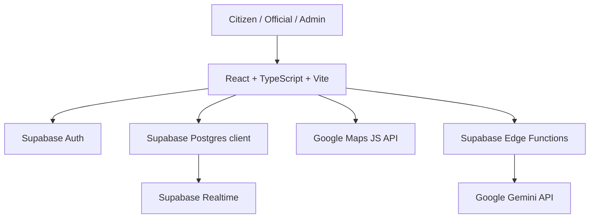

# Civic Pulse AI

A prototype civic-issue reporting and community-awareness application built with React, TypeScript, Vite, Supabase integrations, and experimental AI workflows.

The project explores how residents can document local infrastructure problems, attach media and location details, and how civic teams could review issue reports through role-based dashboards.

> **Project status:** This repository contains a mixture of working UI flows, Supabase-backed hooks/Edge Functions, mock data, and simulated demo behavior. It is a prototype, not a production civic-reporting service. Read [Implementation status and limitations](#implementation-status-and-limitations) before treating any displayed report or AI result as real.

## At a glance

- **Frontend:** React 18, TypeScript, Vite, React Router
- **UI:** Tailwind CSS, shadcn/ui, Radix UI, Lucide
- **Backend services:** Supabase Auth, Postgres client, Edge Functions, Realtime
- **AI integrations:** Gemini API calls from Supabase Edge Functions; experimental TensorFlow.js video component
- **Maps:** Google Maps JavaScript API
- **Data fetching/state:** TanStack Query and React hooks

## Product areas in the codebase

| Area | What the source currently contains |
|---|---|
| Public landing page | Civic issue reporting introduction and navigation |
| Authentication | Citizen registration/login and profile context using Supabase Auth |
| Role-based pages | Protected routes for admin and official experiences |
| Issue reporting UI | Form fields for title, category, description, media, and location |
| Issue browsing | Report cards, status filters, sorting, voting UI, and map views |
| Admin workspace | Report-management UI, official/user management components, analytics, AI insights, automation, and route/video analytics panels |
| AI assistant | Floating civic chatbot backed by a Supabase Edge Function that calls Gemini |
| Image analysis | Image tagging component that invokes the `ai-image-analysis` Edge Function |
| Supabase hooks | A `useIssues` hook for querying, inserting, voting, and subscribing to issue changes |

## Architecture

The intended integration boundaries represented in the repository are:



The frontend is organized into pages, reusable components, hooks, context, and Supabase integration code:

- `src/pages/` — public, login, registration, profile, report, official, admin, and insights pages
- `src/components/` — reporting form, media uploader, maps, issue cards, chatbot, and admin widgets
- `src/context/AuthContext.tsx` — authentication/profile/role state
- `src/hooks/useIssues.ts` — Supabase issue queries, create operation, voting, and realtime subscription
- `src/hooks/useAIAnalysis.tsx` — AI analysis client and image-analysis placeholder
- `supabase/functions/` — server-side Gemini/analysis functions
- `supabase/migrations/` — database migration history

## AI workflows: implemented versus simulated

It is important to distinguish API wiring from validated model behavior.

| Workflow | What the code does | Current caveat |
|---|---|---|
| Image tagging | `AIClassifier` sends an image to the `ai-image-analysis` Supabase function; the function calls a Gemini vision endpoint and parses a JSON-like response | Requires a valid `GEMINI_API_KEY` and a compatible model endpoint. The client falls back to generic tags on failure. Validate the current Gemini model/API version before relying on it. |
| Civic chatbot | `ai-chat` Edge Function sends a civic-help prompt to Gemini | Requires Edge Function secrets and live API validation. |
| Issue analysis | `analyze-issue` reads an issue, finds same-category records, and writes an `ai_analyses` row | Confidence, duplicate, similarity, and other analysis values are generated with random/simulated logic; they are not model-evaluated predictions. |
| Video analysis | The component requests camera access and loads a TensorFlow.js model | The current video-processing function returns hard-coded simulated detections; it does not run inference on extracted video frames. |
| Form category recommendation | The reporting form maps image tags to categories with keyword rules and simulated delay | This is rule-based/demo behavior, not a trained classifier. |

Do not describe the simulated issue/video analysis as validated machine learning in a resume or demo.

## Important implementation status and limitations

The repository currently has two different data paths:

1. **Supabase-backed path:** `src/hooks/useIssues.ts` contains operations to fetch issues, create an issue, record votes, call an analysis function, and subscribe to database changes.
2. **Demo/mock path:** The visible `Reports`, `MyReports`, and `Admin` pages use mock issue/report data. The `ReportForm` currently simulates submission with timers and toast messages rather than calling `useIssues.createIssue`.

Other limitations visible in the source:

- The issue-detail AI analysis button currently simulates a successful analysis instead of invoking the analysis hook.
- The `useAIAnalysis.analyzeImage` helper returns random mock tags.
- Some Supabase migration files in the repository are empty. A fresh Supabase project may therefore require a complete, verified schema migration before it can run.
- The project has no verified production deployment or benchmark results documented here.
- The AI image-analysis function uses a Gemini vision model identifier that should be checked against the currently supported Gemini API models.
- Browser-side publishable/anonymous Supabase keys are not service-role secrets, but production access must be protected by correct Row Level Security policies. Never place a Supabase service-role key or Gemini API key in frontend code.

## Local development

### Prerequisites

- Node.js 18 or newer
- npm
- A Supabase project for backend-backed flows
- Optional: Google Maps API key for map functionality
- Optional: Gemini API key configured as a Supabase Edge Function secret for Gemini-backed functions

### Install and run

```bash
git clone https://github.com/AbdulRehan-7designs/Civic_Pulse_Ai.git
cd Civic_Pulse_Ai
npm ci
npm run dev
```

Vite is configured to serve the development app on:

`http://localhost:8080`

### Environment configuration

Create a local `.env` file (do not commit it):

```env
VITE_SUPABASE_URL=https://YOUR_PROJECT.supabase.co
VITE_SUPABASE_ANON_KEY=YOUR_SUPABASE_PUBLISHABLE_OR_ANON_KEY
VITE_GOOGLE_MAPS_API_KEY=YOUR_GOOGLE_MAPS_API_KEY
```

The Supabase client currently contains a project URL and publishable/anonymous-key fallback. Environment variables are preferred for reproducible setup. A publishable/anonymous key is intended for browser use only when database tables and Storage buckets are secured with appropriate RLS policies.

Set `GEMINI_API_KEY` as a Supabase Edge Function secret, not as a `VITE_*` variable:

```bash
supabase secrets set GEMINI_API_KEY=YOUR_GEMINI_API_KEY
```

Deploy/serve only the Edge Functions you have configured and tested. Review each function's source and the Supabase project schema before enabling it.

## Available scripts

```bash
npm run dev       # Start Vite development server
npm run lint      # Run ESLint
npm run build     # Create production build
npm run preview   # Preview the production build locally
```

## Before presenting this as a live product

- Connect the reporting form to the Supabase-backed `createIssue` path.
- Replace mock report feeds and admin data with database queries.
- Complete and verify the Supabase schema migrations, RLS policies, and Storage policies.
- Replace simulated video/issue analysis with real inference or label those panels as demos.
- Validate Gemini model identifiers, error handling, quotas, and secret configuration.
- Add automated tests for auth, reporting, voting, role boundaries, and Edge Functions.
- Add screenshots and a short screen-recorded walkthrough after testing the app end to end.

## License

The repository currently contains an MIT license statement in its project setup; verify that a complete root-level `LICENSE` file is present before relying on the license for redistribution.
